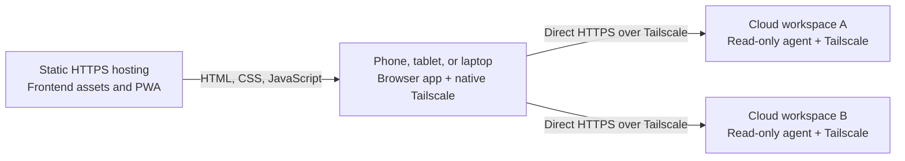

# Split host implementation plan

Architecture agreed on 2026-10-13. Steps 2–11 are committed. Cloud/device feasibility remains
pending. This record owns remaining work and release acceptance; implemented contracts belong to the
linked behavior records. Git retains the original research, proposals and delivery history.

## First release and agreed boundaries

Serve a stable static HTTPS frontend that connects directly to read-only agents in cloud workspaces
through the device's native Tailscale app. The user can close the laptop while those workspaces
remain available. Saved feedback must remain accessible when an agent disappears.

Keep one repository with independently deployable web and agent artifacts. The frontend delivery
account belongs to the trust boundary because its JavaScript can read connected repositories.
Tailscale policy controls private agent reachability.

Manual URLs and startup-generated connection links are the first bootstrap. Discovery, a stable hub,
cross-device sync, automatic draft transfer, offline repository caching and no-internet app-shell
startup are outside this release. Typed feedback is the baseline; cloud dictation needs configured
and verified tools.

## Implementation sequence and review checkpoints

Work in separate reviewable slices and leave each uncommitted until explicit maintainer commit
approval, following [AGENTS.md](../AGENTS.md). Local implementation is authorized while the real
cloud/device gate is pending.

| Step | Reviewable result                              | Decisive evidence                                                                     |
| ---- | ---------------------------------------------- | ------------------------------------------------------------------------------------- |
| 1    | Cloud/browser feasibility proof                | Real device reaches private HTTPS agent from static HTTPS page with laptop closed     |
| 2    | Three workspaces, preserved behavior           | Existing build, run, tests, and representative QA still work                          |
| 3    | Complete static web artifact                   | Root and subpath deployments work without the source checkout                         |
| 4    | Independent agent artifact                     | Agent starts and serves code without frontend assets or macOS-only tools              |
| 5    | Protocol information and complete CORS         | Compatible allowed-origin GET, POST, errors, and media; rejected invalid preflight    |
| 6    | Explicit browser transport                     | Every request/media family reaches the selected endpoint                              |
| 7    | Endpoint-owned routes and runtime state        | Same paths/version tokens on two agents cannot mix; late results are rejected         |
| 8    | New persistence and backup foundations         | Validated endpoint/path ownership, exact history preservation, offline round trips    |
| 9    | Explicit legacy-data conversion and import     | Failed writes preserve old data; new-origin transfer works before deployment cutover  |
| 10   | Saved-feedback recovery                        | Initial agent failure still allows all saved feedback/history to be viewed and copied |
| 11   | Connection management and saved-project access | Paste/link bootstrap, independent tabs, unavailable entries, and retained reviews     |
| 12   | Cloud recipe and release verification          | Two-agent workflow, actual provider/device lifecycle, installation, and recovery pass |

### 1. Prove the target cloud and browser path

The [feasibility QA procedure](qa-workflow.md#split-host-feasibility-probe) owns the probe, local
evidence, commands and cloud setup instructions. Local HTTP/private HTTPS simulation is complete. It
does not establish real cloud lifetime or physical-device reachability.

Choose the provider/setup hook, frontend origin/base path, required availability period and first
device/browser. Verify private HTTPS access from the static frontend with the laptop closed,
including after setup, AI task completion and idle/suspend. If that fails, resolve the provider or
transport choice before deployment.

### 2. Move into three workspaces without changing behavior

Completed. [Engineering conventions](engineering-conventions.md#code-organization-and-interfaces)
own the workspace/dependency boundaries. Two deployed applications justify separate packages; shared
source remains locally consumed without independent publishing.

### 3. Produce the complete static frontend

Completed. [Static build and delivery](../README.md#build-the-static-frontend) and
[installation behavior](independent-tabs-and-pwa-proposal.md#installation-and-offline-behavior) own
the result; [artifact QA](qa-workflow.md#static-web-artifact) owns its checks.

### 4. Produce the independent agent runtime

Completed. [Agent operation](../README.md#build-and-run-the-independent-agent) owns prerequisites
and packaging; [artifact QA](qa-workflow.md#independent-agent-artifact) owns its checks.

### 5. Add protocol information and the CORS boundary

Completed. [Agent protocol](agent-http-protocol.md) owns the contract and
[frontend-origin configuration](../README.md#agent-information-and-frontend-origins) owns operation.

### 6. Route all browser traffic through an explicit endpoint

Completed. [Explicit browser connections](agent-http-protocol.md#explicit-browser-connection) own
transport and media binding; [transport QA](qa-workflow.md#explicit-client-transport) owns the
runnable check.

### 7. Scope navigation, sessions, and runtime caches

Completed. [Navigation](navigation-and-url-history-slice-proposal.md),
[project identity](stateless-project-access-plan.md), [loading](loading-and-transition-polish.md)
and [local data](independent-tabs-and-pwa-proposal.md#local-data-and-backups) own their contracts.

### 8. Build persistence and backup foundations

[The local-data owner](independent-tabs-and-pwa-proposal.md#local-data-and-backups) owns storage and
backup behavior. [Foundation QA](qa-workflow.md#endpoint-owned-data-foundation) owns the command.
Activation belongs to step 9.

### 9. Activate persistence with explicit legacy conversion

[Local data](independent-tabs-and-pwa-proposal.md#local-data-and-backups) owns activation, explicit
legacy assignment, conversion and global backup behavior.
[Cutover QA](qa-workflow.md#endpoint-owned-data-foundation) owns the runnable check.

### 10. Make saved feedback independent of live source

[Feedback recovery](feedback-slice-proposal.md#saved-feedback-recovery) owns source-independent
viewing/copying and live rechecking;
[local data](independent-tabs-and-pwa-proposal.md#local-data-and-backups) owns its export.
[Recovery QA](qa-workflow.md#saved-feedback-recovery) owns the command.

### 11. Add connection management and saved-project navigation

[Host management](agent-http-protocol.md#host-management) owns manual/link bootstrap, checks, labels
and connection removal; [navigation](navigation-and-url-history-slice-proposal.md) owns destinations
and independent selection. [Host QA](qa-workflow.md#host-management) owns the runnable workflow and
responsive captures. Discovery remains deferred.

### 12. Finish cloud bootstrap and verify the release

Turn the probe setup into a generic Linux recipe and one verified provider hook. It installs
prerequisites, enrolls Tailscale, starts the approved-root packaged agent, configures private HTTPS
and the allowed frontend origin, then prints the actual agent URL and frontend connection link.
Runtime operation stays in the README; provider setup and verification stay in the QA guide.

Choose a unique workspace hostname after instantiation; reused images must not share enrollment
state or names. [Ephemeral nodes](https://tailscale.com/docs/features/ephemeral-nodes) get a new IP
on creation, but [machine-name rules](https://tailscale.com/docs/concepts/machine-names) do not
promise permanent hostname uniqueness. URL/path ownership therefore requires a deliberate unique
name per independent workspace. Continuing the same workspace can retain its name; print the actual
resulting address because Tailscale may adjust it.

[Userspace networking](https://tailscale.com/docs/concepts/userspace-networking) may help without
TUN privileges, but inbound Serve access must be verified in the actual environment. Ephemeral-node
cleanup does not keep a cloud process or checkout alive. Verify setup hooks, network availability,
secret access, checkout/worktree retention, and process lifetime after task completion and
idle/suspend. A static UI cannot read a workspace the provider has destroyed.

Document secrets, normal exit/restart, node cleanup, availability limits and optional voice
capabilities. Test packaged artifacts. Public deployment is the final reviewed action when
requested.

## Release gate and handoff

Release requires independently usable artifacts, real-device direct HTTPS access to two agents,
isolation through host switches/reconnects, saved-feedback recovery, safe legacy/origin transfer,
and the agreed provider lifetime with the laptop closed. Step 1 establishes feasibility; steps 9–12
complete the user workflow and integrated acceptance.

Follow [AGENTS.md](../AGENTS.md) and the [QA workflow](qa-workflow.md) for checks, isolation,
screenshots and handoff. Record actual provider/browser/device coverage and remaining gaps.
Completed per-step logs and test counts belong in Git history, not duplicated behavior records.

## Deferred discovery

The native Tailscale app supplies routes and DNS, without an ordinary page API for enumerating its
peers. MagicDNS resolves a known hostname. Bootstrap through manual URLs or printed links is covered
by step 11.

A connected agent could later report filtered candidates through its local
[Tailscale CLI](https://tailscale.com/docs/reference/tailscale-cli) view. Its inventory is subject
to [device visibility](https://tailscale.com/docs/concepts/device-visibility); the device still
needs its own authorization and reachability. This cannot bootstrap when no known agent is online.

Tailscale's
[tsconnect source](https://github.com/tailscale/tailscale/blob/main/cmd/tsconnect/README.md) and
[SSH Console](https://tailscale.com/docs/features/tailscale-ssh/tailscale-ssh-console) establish a
separate browser-node alternative. Enrollment, HTTP/media integration, mobile resource use and API
stability would need their own investigation.

### Tailscale API tokens and sign-in

Tailscale does provide inventory through `GET /api/v2/tailnet/{tailnet}/devices`. The
least-privilege scope for that endpoint is `devices:core:read`, documented under
[trust credentials](https://tailscale.com/docs/reference/trust-credentials). This supplies device
candidates, not proof that a compatible review agent is running or reachable from the phone. Filter
the intended review-agent tag and perform an application health/protocol check.

An [OAuth client](https://tailscale.com/docs/features/oauth-clients) uses a client ID and secret to
obtain API access tokens, which expire after one hour. Its secret can live on an agent or a managed
function. A copied short-lived token also authorizes inventory, but putting it in a browser does not
override the API's CORS behavior. A provisioned Tailscale node's auth key is a different credential
and should not be treated as an inventory token.

On 2026-10-12, made unauthenticated HTTPS OPTIONS probes to both the device-list and token
endpoints, with `Origin: https://example.github.io`. The device-list probe requested GET with an
Authorization header; the token probe requested POST with Content-Type. Both returned HTTP 200
without Access-Control-Allow-Origin or other CORS permission headers. A browser cannot complete the
tested cross-origin authenticated device-list request. This is an observation for the tested
origin/endpoints, not a guarantee about every future API configuration. No credentials or private
inventory were used or retrieved.

[OAuth apps](https://tailscale.com/docs/features/oauth-apps) offer Tailscale-hosted consent but are
currently alpha. The documented
[provisioning flow](https://tailscale.com/docs/features/oauth-apps/device-provisioning) requests
`auth_keys:create:once`, exchanges its code using a client secret, and returns a single-use
enrollment token. It does not establish a browser-only, PKCE-based device-inventory authorization
flow. Do not infer arbitrary inventory scopes from the general OAuth app description.

[tsidp](https://tailscale.com/docs/features/tsidp) is another sign-in option: an OIDC identity
provider deployed within the tailnet. It introduces a running identity service and is not itself the
device inventory API. Neither signing into the Tailscale admin console nor native VPN login
automatically grants the static page access to those sessions or administrative API authorization.

There are two practical ways to use API-backed inventory while preserving direct repository traffic:

- Add a small **authenticated managed function** that holds only the read-only inventory credential,
  obtains tokens, and returns filtered agent candidates. It needs public HTTPS access to the
  Tailscale API, not a tailnet node or repository access. It can work when every agent is offline.
  This adds a dynamic component and caller authentication, but requires no user-operated VM and does
  not proxy repository bytes. It is an optional architecture choice, not part of the strictly static
  model.
- Have an **already connected agent** query the control API with a scoped credential, or use its
  local peer view without a control API credential. This adds no separate service. It remains unable
  to bootstrap when no known agent is reachable; its API inventory access is not the phone's network
  authorization.

For a strictly static first version, keep connection-link bootstrap and defer discovery. A connected
agent can provide optional discovery later. If discovery before connecting to any agent becomes a
priority, evaluate the small managed metadata function separately from the earlier full web hub. Do
not promise that pasting an API token alone supplies this bootstrap in an ordinary static browser
app.

## Browser feasibility

Implemented request policy belongs to [the protocol owner](agent-http-protocol.md). The browser
constraints below remain external feasibility questions from the 2026-10-12 research.

### HTTPS and local-network permissions

Use HTTPS for both frontend and agents. A static HTTPS page calling an HTTP agent faces
mixed-content restrictions; encrypted VPN transport alone does not turn an HTTP URL into a browser
secure context. See
[mixed-content documentation](https://developer.mozilla.org/en-US/docs/Web/Security/Defenses/Mixed_content).

[Tailscale Serve](https://tailscale.com/docs/features/tailscale-serve) can expose a loopback HTTP
agent privately over HTTPS with a tailnet domain and apply network access policy. Enable the
required tailnet HTTPS/Serve permissions before automating workspace startup, so bootstrap does not
depend on an interactive consent step. Use the actual HTTPS hostname, not a raw IP with a mismatched
certificate.

Public frontend to tailnet agent requests also need browser permission testing. The current
[Local Network Access draft](https://wicg.github.io/local-network-access/) classifies
`100.64.0.0/10`, used for Tailscale IPv4, as local. Chrome's
[implementation guidance](https://developer.chrome.com/blog/local-network-access) describes its
permission approach, replacing the earlier PNA experiment. HTTPS does not remove that permission
boundary. Establish current behavior on iPad Safari, installed iOS mode, Android Chrome, and
desktop, including the actual IPv4/IPv6 resolution. A permission prompt is a usability step; a
browser combination that blocks the required requests is a feasibility issue to resolve before wider
work.

## Comparison with the hub proposal

| Concern                                     | Static frontend with direct agents                      | Stable hub with proxied agents                                               |
| ------------------------------------------- | ------------------------------------------------------- | ---------------------------------------------------------------------------- |
| User-operated always-on application service | None                                                    | Hub needs deployment, updates, and persistent config                         |
| Where host connections are remembered       | Each browser/device                                     | Hub registry                                                                 |
| Browser-to-agent network access             | Device needs Tailscale and HTTPS/CORS-compatible agents | Browser needs access to hub; hub reaches agents                              |
| Bootstrap/discovery                         | Paste/link; optional discovery through a known agent    | Central inventory available while hub is online                              |
| Repository traffic                          | Device directly to selected agent                       | Passes through the trusted hub                                               |
| Latency/bandwidth                           | Direct route                                            | Extra hop and hub bandwidth                                                  |
| Frontend stability                          | Static platform provides stable UI address              | Hub deployment provides stable UI address                                    |
| Cloud environment disappearance             | Agent unavailable                                       | Agent also unavailable; hub cannot retain live state without separate copies |
| Host-owned state and backup migration       | Required                                                | Required                                                                     |
| Browser-specific cross-origin behavior      | Must be tested                                          | Simplified by one origin                                                     |

The static model removes gateway implementation, server registry persistence, and hub operations. It
adds complete agent CORS, deployable static/PWA assets, browser-local host management, and direct
browser/device QA. Scoping existing state to its endpoint/project and separating saved feedback from
live source remain substantial correctness changes in either approach.
