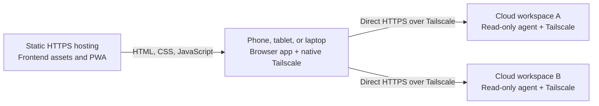

# Split host implementation plan

Status: architecture agreed on 2026-10-13; step 1 probe preparation and local HTTP/private HTTPS
simulation are complete, with the cloud/device feasibility gate pending. Steps 2–6 are committed;
endpoint-owned routes and runtime state are next. Research began on 2026-10-12. The accepted
direction is a static frontend, direct private agents, manual URL or startup-generated connection
links, URL plus canonical project path ownership, and saved-feedback recovery. Discovery is optional
and deferred. This record owns the implementation sequence and release gate; existing behavior
records remain authoritative until each change is implemented.

## First release and agreed boundaries

The first release lets the user install one stable HTTPS frontend, connect it to two or more
cloud-workspace agents over the device's native Tailscale connection, and review code with the
laptop closed. If an agent disappears, its saved projects remain openable for feedback/history
viewing, recovery copy, and local export. Live repository access remains read-only.

Use the three-workspace layout described under
[repository structure](#repository-structure-and-build-targets): `apps/web`, `apps/agent`, and
`packages/shared`. Keep local development and the current review app usable throughout the
transition. The cloud startup recipe gives independent workspaces unique hostnames; changing an
endpoint creates a separate connection and never silently moves reviews.

Typed review is the portable baseline. Preserve existing configured local dictation, but advertise
cloud transcription as unavailable unless its tools are configured and verified. No stable hub,
Tailscale inventory integration, cross-device sync, automatic draft transfer, offline repository
cache, or no-internet app-shell startup belongs to this release.

## Implementation sequence and review checkpoints

Each numbered step is a separate reviewable change, not a promise of one commit or one day. Complete
its focused checks and explain the result before moving to the next substantial step. Leave work
uncommitted until explicit maintainer commit approval. The maintainer has requested source
implementation; local work may proceed while cloud/device verification remains a release gate.

| Step | Reviewable result                              | Decisive evidence                                                                     |
| ---- | ---------------------------------------------- | ------------------------------------------------------------------------------------- |
| 1    | Cloud/browser feasibility proof                | Real device reaches private HTTPS agent from static HTTPS page with laptop closed     |
| 2    | Three workspaces, preserved behavior           | Existing build, run, tests, and representative QA still work                          |
| 3    | Complete static web artifact                   | Root and subpath deployments work without the source checkout                         |
| 4    | Independent agent artifact                     | Agent starts and serves code without frontend assets or macOS-only tools              |
| 5    | Protocol information and complete CORS         | Compatible allowed-origin GET, POST, errors, and media; rejected invalid preflight    |
| 6    | Explicit browser transport                     | Every request/media family reaches the selected endpoint                              |
| 7    | Endpoint-owned routes and runtime state        | Same paths/version tokens on two agents cannot mix; late results are rejected         |
| 8    | New persistence and backup foundations         | Validated endpoint/path ownership, exact history preservation, offline round trips    |
| 9    | Explicit legacy-data conversion and import     | Failed writes preserve old data; new-origin transfer works before deployment cutover  |
| 10   | Saved-feedback recovery                        | Initial agent failure still allows all saved feedback/history to be viewed and copied |
| 11   | Connection management and saved-project access | Paste/link bootstrap, independent tabs, unavailable entries, and retained reviews     |
| 12   | Cloud recipe and release verification          | Two-agent workflow, actual provider/device lifecycle, installation, and recovery pass |

### 1. Prove the target cloud and browser path

Choose the first provider/environment, frontend origin/base path, and required availability period.
Use a bounded static probe page and a small agent harness around the existing API; it can use
`/api/roots` and existing read routes without waiting for the new protocol endpoint. The harness may
exercise the intended CORS response wrapper, but must not relax repository boundaries. Test one
small repository read, a JSON POST, and image/audio/video requests including seeking through ranges.

Enroll a unique ephemeral Tailscale hostname, expose loopback through private HTTPS, and try the
probe from an actual iPad/phone with the laptop closed. Check the cloud process after setup, during
the AI task, after task completion, and through the needed idle/suspend period. Record the actual
browser/OS, permission prompts, provider hooks, network mode, lifecycle, and any remaining limits.

Review checkpoint: evidence that this environment can support the intended review period. Desktop
loopback tests or command-line requests do not satisfy this gate. The maintainer explicitly
requested continuing local implementation on 2026-10-13 while cloud validation is pending. If
provider testing later fails, review the provider or transport choice before deployment. Keep only
useful bounded probe tooling; record procedures/evidence in the [QA guide](qa-workflow.md), not a
second architecture record.

The bounded [probe harness](../qa/feasibility-agent.ts), [static page/build](../qa/feasibility.ts),
disposable Git/media fixture, and local simulation are now prepared. The
[feasibility QA procedure](qa-workflow.md#split-host-feasibility-probe) owns commands, cloud setup,
and evidence. Local browser transport works through HTTP and private Tailscale Serve HTTPS; the
actual cloud lifecycle and physical-device gate remain open. This local evidence does not establish
that an OpenAI cloud workspace supports inbound access or the required availability period.

### 2. Move into three workspaces without changing behavior

Move current client, server, and shared code into the agreed packages. Assign Preact to web and
Shiki to agent; keep root toolchain versions, lockfile, QA fixtures, and orchestration. Introduce
explicit shared subpath exports and preserve the strict browser/agent/worker/test/QA checks. Add a
focused production import/dependency boundary check. Do not introduce publishing or
project-reference builds.

Update root scripts, QA imports, documentation/source links, and AGENTS.md references for the moves.
Keep a root development composition for the existing same-origin review workflow, without requiring
production app-to-app imports. Verify the current configured local voice path is retained.

Review checkpoint: a mechanical move with no intended user-visible change. Run type checks, unit
tests, QA/format gates, build/start smoke checks, and representative project/review/navigation QA.
The combined same-origin entrypoint belongs to root [development composition](../scripts/serve.ts),
while web, agent, and shared source stay within their package boundaries. Independent production
artifacts remain steps 3 and 4.

Committed on 2026-10-13. Root build/dev/start commands retain their behavior; the single lockfile
retains existing dependency versions. The production boundary gate covers 121 source files,
including type imports and re-exports, and rejected deliberate temporary cross-app/shared-host
imports. Strict TypeScript, all 306 tests, QA/format, and build checks passed. Disposable-fixture
browser checks passed for phone project selection/reload, checked feedback copy, history/Undo and
clipboard fallback, and responsive URL/Back/Forward navigation. The normal HTTPS app was restarted
with its existing approved root, port, and origin. The source-only probe bundle was re-extracted and
all ten browser checks passed again without frontend source/assets.

Inspected the unchanged app layouts at [phone](../qa/screenshots/workspace-migration/mobile.png),
[tablet portrait](../qa/screenshots/workspace-migration/tablet-portrait.png),
[tablet landscape](../qa/screenshots/workspace-migration/tablet-landscape.png), and
[desktop](../qa/screenshots/workspace-migration/desktop.png). Voice implementation/configuration
paths were preserved and transcription tests passed; real microphone/dictation and physical-device
gesture checks were not repeated. Cloud lifetime and laptop-closed use remain open release gates.

### 3. Produce the complete static frontend

Committed on 2026-10-13. The slice adds `build:web` with a validated deployment base path and a
self-contained `dist/web` directory. Existing local build/run commands keep the current review app
usable. Query routes, known history, manifest launch/scope, worker registration and offline retry
share that deployment path. Versioned scripts/styles allow immutable asset delivery; HTML, worker,
manifest and fallback revalidate. Each deployment owns its fallback cache, and upgrades do not
reload tabs or touch saved review storage. Static-only hosting uses early meta-CSP; an optional
generated header file adds framing protection and cache headers on hosts that support it. The
fallback describes app-site unavailability. Direct agent traffic and connection configuration remain
later steps.

Add `build:web` and a self-contained publish directory containing HTML, content-versioned scripts
and styles, icons, manifest, worker, and offline fallback. Make navigation, resource paths, install
scope, and worker registration honor the deployment base path. Preserve query-based deep links.

Define the static CSP and update/cache delivery policy. The first version accepts user-entered HTTPS
agents, so connection/image/media policy must permit those destinations while script/style policy
stays restricted. Decide the supported host's header or meta-CSP configuration explicitly. Do not
assume a fixed list of future ephemeral hostnames can be baked into the build. Keep API/media out of
worker caches and preserve drafts during incompatible-version or frontend-update recovery.

Review checkpoint: serve the artifact from a temporary directory without source-tree files at both
`/` and a GitHub-Pages-style subpath. Verify HTML/assets, deep-link refresh, manifest/icons, worker
scope, and asset requests within the intended deployment paths. Live agent traffic moves in step 6;
this review proves static packaging/install assets, not a working direct-agent deployment. The
existing development composition still provides the usable review app.

The [static-artifact QA](qa-workflow.md#static-web-artifact) passed with copied root/subpath builds
served outside the checkout and no API/CSP response header. It verifies native worker replacement,
scoped cleanup, unchanged saved feedback/history and tab lifetime, offline styling/retry, resource
and install paths, and invalid-build preservation. The existing PWA/backup browser scenario also
passed, along with strict TypeScript, all 310 tests, QA/format and local/static builds. Hosting
instructions and meta/header limits belong in the [README](../README.md#build-the-static-frontend);
the [installation owner](independent-tabs-and-pwa-proposal.md#installation-and-offline-behavior)
owns current caching/navigation behavior. Public-provider delivery and physical-device installation
remain unverified. No public deployment or cloud environment was changed.

### 4. Produce the independent agent runtime

Committed on 2026-10-13. The slice packages a Bun-targeted `dist/agent/agent.js`, with Shiki's
language loaders and inlined Oniguruma engine bundled rather than resolved from a checkout at
runtime. Copying that directory to a workspace requires Bun, Git and ripgrep, but no frontend,
package installation or application source. A workspace `build` target and root `build:agent`
produce the same artifact; `start:agent` runs it with an explicit approved root. The current
same-origin app continues to use its local composition. This step does not publish a package or
executable for each OS/architecture.

The existing root/port/bind/proxy-origin configuration is shared so both entrypoints validate it in
one place. The standalone entrypoint serves the existing API only; static paths return 404. Invalid
configuration or an unavailable approved root fails before listening. Loopback remains the default;
the existing explicit Tailscale IPv4 option remains available. CLI/help and startup output describe
an API-only agent and optional transcription without promising that a model is usable. FFmpeg
discovery also checks PATH for Linux installations; explicit executable overrides retain precedence
and errors stay request-local. No protocol, project identity, CORS or browser request shape changes
here.

Root `build` now produces the local assets and both independent artifacts; `dev` builds only the
local assets before starting the existing composition. Tailscale enrollment, Serve and supervision
remain external to the runtime. The [README](../README.md#build-and-run-the-independent-agent) owns
operation and prerequisites; the [voice owner](local-voice-comment-slice-proposal.md) owns request
and model behavior.

The [artifact check](qa-workflow.md#independent-agent-artifact) passed against a copied package and
disposable Git fixture outside the checkout. It exercises roots, canonical projects, files/trees,
actual cold syntax including embedded TypeScript, Search, Git status/diff/history, API-only routing,
outside-root and symlink rejection, invalid startup, and unchanged fixture/Git data. Startup with
unset voice configuration and unavailable-tool requests passed; configured voice uses stub tools to
verify arguments, text validation and temporary cleanup. This does not establish real model
inference, Linux/provider execution or physical-device behavior. Strict TypeScript, all 313 tests,
QA/format, and local/static/agent builds passed. The existing browser restart scenario passed across
Changes, Files, Search, Git, media, checked copy and retry with saved drafts/editor/history
retained. The current app was restarted with the existing approved root, port and proxy origin, and
its private HTTPS root read passed. Cloud/device lifetime and direct-agent deployment remain later
gates.

### 5. Add protocol information and the CORS boundary

Committed on 2026-10-13. The agent now has a shared, validated information handshake and an explicit
frontend-origin list separate from its private HTTPS address. A single HTTP boundary validates route
methods/preflights before repository work and decorates allowed-origin successes, errors and
streams. The [protocol owner](agent-http-protocol.md) owns compatibility, capabilities, origin
policy and response behavior; exact wire types live in shared source.
[The README](../README.md#agent-information-and-frontend-origins) owns configuration.

The [cross-origin browser check](qa-workflow.md#agent-information-and-cross-origin-http) passed
against a copied production bundle with a disposable static origin and Git/media fixture. Real
preflight, JSON batch/feedback POSTs, readable errors/stale results, native image/audio/video,
seeking, HEAD and streamed ranges passed; invalid methods/headers and an unconfigured origin were
blocked. The packaged-runtime check also covers missing optional tools and transcription
unverified/verified/revoked states through stubs. Handler/parser tests cover route families,
non-dispatching rejected preflights, compatibility, Vary, errors and stream cancellation. All 322
tests, strict TypeScript, QA/format and local/static/agent builds passed. The same-origin browser
restart check passed with review state preserved. The normal app was restarted with its existing
approved root/port/proxy origin, and its private HTTPS information endpoint passed. This backend
slice does not change frontend selection/storage; source transport, actual cloud/Linux lifetime,
public/private HTTPS permission behavior and physical devices remain later gates.

### 6. Route all browser traffic through an explicit endpoint

Committed on 2026-10-13. The [protocol owner](agent-http-protocol.md#explicit-browser-connection)
owns normalized endpoint and request policy, the bound API/provider, instance-owned diff queues and
source-validated absolute media URLs. Every request family, including polling, source checks,
context, transcription and native media, now uses an explicitly supplied connection. The normal app
retains its page-origin bootstrap while endpoint-owned state and persisted data are pending. No host
selector is active.

Review checkpoint: the [client transport QA](qa-workflow.md#explicit-client-transport), request
inventory and unit checks prove routing, isolated queues, deferred reads, cancellation and rejected
fetch redirects. Step 7 must still prevent route/session/cache and late-result ownership from
crossing agents before multi-host selection is exposed.

Strict TypeScript, all 331 unit tests, local/static/agent builds and the current stateless restart
browser scenario passed. Real Chrome APIs reached each selected agent from a static-only origin;
native media, raw links and anonymous audio/video seeking passed. Four responsive media captures
were inspected without overflow. QA/format and documentation-link checks accompany this review. The
normal app's rebuilt frontend remains available. Cloud/device and secure public/private browser
permission proof remain open release gates.

### 7. Scope navigation, sessions, and runtime caches

Carry endpoint plus canonical project path through project/session models and runtime ownership.
Routes must identify the host and project explicitly; existing file/section/Search/Git destinations
remain URL-owned. Use canonical project references after selection, while the picker keeps its
root-relative browsing metadata. Preserve the deployment base path and Back/Forward behavior.

A destination referencing an unknown connection offers Add host before making agent requests; it
must not silently choose the last host. A saved local reference can be opened without a handshake.
Resolve old single-host links only against the explicitly configured legacy endpoint, and replace
them with the new canonical route after successful resolution; do not reinterpret them on a cloud
host. An unresolved old link remains recoverable rather than guessing a project. Save pending editor
text before navigation, cancel old work synchronously, and prevent late results, notices, focus, and
caches from affecting another endpoint's project. Scope tab restoration, reading positions,
diff/Git/batch-source keys, and root/picker state appropriately.

Review checkpoint: two agents with identical canonical paths and deliberately equal version tokens
return visibly different content. Switch during slow checks/diff/media loads, then navigate Back,
Forward, and between tabs; no content or transaction result may cross owners. Keep multi-host user
selection unavailable until step 9 activates endpoint-owned persisted data.

### 8. Build persistence and backup foundations

Implement validated connection records, saved-project metadata, and endpoint/project-keyed review
and preference stores under new namespaces. Add a saved-project index independent of the bounded
recents list, with a reconciliation path for valid review records missing an index entry. Global
appearance/typography choices stay global; root-scoped recents/picker metadata include their
endpoint.

The new backup carries endpoint ownership, saved project metadata, drafts/anchors/quotes, exact
copied text/history, connection configuration, and applicable preferences. Global export covers
stored reviews across remembered hosts, including unreachable hosts and reviews outside an agent's
current root. It requires no live root/project lookup. Imported metadata is local recovery data and
never grants filesystem access. Preserve the new backup's endpoint associations on import.

Review checkpoint: parser/round-trip tests cover duplicate paths on different hosts, malformed and
conflicting records, quote/range fidelity, exact history, export with every agent offline, and
storage denial/quota errors. Build these foundations without switching existing users' storage yet;
step 9 owns activation and legacy conversion together.

### 9. Activate persistence with explicit legacy conversion

Before frontend-origin cutover, provide a preview that assigns existing path-only review data to an
explicit intended endpoint. Scope conversion to currently supported source formats, retain draft
IDs/bodies/anchors/timestamps and exact history, and do not automatically map old data to the first
cloud host. Supported legacy backups use the same explicit assignment flow.

Write and verify new records before publishing completed migration state or retiring old records.
Failed/partial writes preserve the legacy source and a recoverable review; partial conversion must
not become authoritative. Never repeatedly import later writes from an older tab. Explain that old
tabs need reloading, and retain the existing limit that concurrent edits have no conflict
resolution. Import previews replacement of matching endpoint/project records; unrelated reviews
remain intact.

Review checkpoint: same-origin conversion, offline import/export, interrupted/quota-failed writes,
and a real old-origin export/new-origin import exercise. Old-origin browser storage cannot be read
by the new origin. Document backup transfer before redirecting users to the new static site, and
keep the old-origin export path available through the migration period.

### 10. Make saved feedback independent of live source

Load the saved project and review before connection/root/project requests settle. Introduce separate
saved-review and live-source states instead of requiring a live `Project` for feedback. Add the
unavailable Changes state, saved count, existing Feedback/history access, and Retry. Network,
protocol, permission, root, and project failures must preserve local access and explain the live
failure without presenting cached quotes as current changes.

Add the explicit recovery formatter/copy path described under
[saved feedback](#saved-feedback-when-an-agent-is-unavailable). Include every saved draft and its
last-known state, label freshness as unverified, and preserve drafts after successful recovery copy.
Retain exact history-copy behavior. Normal checked copy/archival/Undo and source reattachment keep
their existing safeguards. Clipboard failure provides selectable text; recovery copy never invokes
the source checker or reports a successful check.

Review checkpoint: save current and outdated drafts plus history, stop the agent, reload the static
UI, and open the project. View/copy/export must work without successful agent requests. Also stop it
mid-review or during checking, navigate away during clipboard completion, reconnect, and verify
normal checked copy still behaves correctly. Capture and inspect all four screen sizes, including
long hostnames/paths and wrapping recovery text.

### 11. Add connection management and saved-project navigation

Expose Add host/manual URL and generated-link prefill, connection labels/status, host-specific
picker/recents, and saved projects with feedback. A pasted/link destination goes through normal
validation and protocol checking before live use; failed connections must not replace active work.
Accepting a connection is an explicit user action, while opening an existing saved review needs no
successful connection. Consume connection-prefill data without leaving a competing active route.

Keep endpoints immutable. Rename a display label freely; a different URL is Add host, with no draft
reassignment. Removing a connection preserves its saved reviews in the recovery list and backup. Any
future destructive review deletion must be explicit. Each tab selects its own endpoint/project.
Unavailable status must have text as well as color, accessible controls, and usable touch targets.

Review checkpoint: add two agents, review identical paths, open a printed link on a fresh device,
reject malformed/incompatible endpoints, switch independent tabs, remove an unavailable connection,
and still find/copy its feedback. Capture phone, tablet portrait/landscape, and desktop host/picker
and saved-review states. Discovery remains absent from this slice.

### 12. Finish cloud bootstrap and verify the release

Turn the feasibility setup into a documented generic Linux recipe plus one verified provider hook:
install prerequisites, enroll a unique ephemeral hostname, start the approved-root agent, configure
private HTTPS and allowed frontend origin, wait for readiness, and print the actual agent URL and
frontend connection link. Reuse a workspace-specific name when continuing that same workspace;
independent cloned tasks get new names. Print no auth keys or administrative tokens.

Document secrets, normal exit/restart and node cleanup, availability limits, and optional voice
capabilities. Test packaged artifacts, rather than source-tree entrypoints, in the provider.
Document static publishing/root-versus-subpath configuration and make public deployment the final
reviewed action when that work is requested.

Review checkpoint: complete the [release gate](#release-gate-and-handoff) with the real cloud
environment and device. Fold implemented contracts into their behavior owners, update run and QA
instructions, and reduce this plan to scope/acceptance/remaining limits when the stage is closed.

## Data and API work by boundary

These describe responsibilities, not duplicated executable schemas. Shared source owns exact types,
protocol revisions, supported fields, validators, storage versions, and limits.

| Boundary                 | Planned shape and ownership                                                                                                | First introduced |
| ------------------------ | -------------------------------------------------------------------------------------------------------------------------- | ---------------- |
| Agent information        | Application/protocol version and usable capabilities; no workspace UUID or Tailscale credential                            | Step 5           |
| Agent repository API     | Existing stateless `projectPath` read contract and approved-root validation; CORS surrounds all responses                  | Steps 4–5        |
| Connection               | Immutable normalized endpoint plus local label/configuration; live health/protocol observation is separate                 | Steps 6–8        |
| Project/review reference | Endpoint plus canonical absolute path; last-known name/root/navigation metadata for recovery, never read authorization     | Steps 7–8        |
| Saved review             | Existing draft bodies/anchors/quotes and exact history under composite ownership; loading does not require a live project  | Steps 8–10       |
| Live source session      | Explicit loading/available/failure lifecycle, bound to its current endpoint/project/request generation                     | Steps 6–7, 10    |
| Backup/import            | Offline export of remembered local data; preserved endpoint ownership; explicit assignment only for legacy path-only input | Steps 8–9        |
| Navigation               | Host/project destination in URL, independent per-tab fallback, picker root metadata scoped to endpoint                     | Steps 7, 11      |

On implementation, [stateless access](stateless-project-access-plan.md) owns composite project
identity and read authorization; [local data](independent-tabs-and-pwa-proposal.md) owns connection
storage, conversion, backup, and installation; [Feedback](feedback-slice-proposal.md) owns recovery
versus checked-copy behavior; [Navigation](navigation-and-url-history-slice-proposal.md) owns host
destinations. Run/build/bootstrap instructions belong in the root README, and executable QA belongs
in the QA guide. Update each owner when its step lands rather than maintaining parallel contracts.

## Release gate and handoff

The first release is ready only when all of these are demonstrated:

- The web publish directory and agent runtime each operate without the other artifact or checkout.
  Root and subpath static deployments support deep links, install metadata, worker scope, CSP, and
  update recovery.
- A real device connects from the static frontend to two compatible private HTTPS agents; JSON,
  POST/streaming batches, source checks, images, and audio/video seeking all work. Record actual
  iOS/Android/browser coverage and gaps rather than treating emulation as device evidence.
- Duplicate project paths/version tokens, independent tabs, delayed replies, switching, and
  reconnect cannot mix content, caches, reviews, clipboard archival, or notices across endpoints.
- Both initial unreachability and disappearance during review preserve openable saved projects,
  every draft/quote, exact history, recovery copy without clearing, and JSON export. Retry restores
  fresh live behavior; inaccessible source is never fabricated.
- Legacy assignment, failed writes, and old-origin export/new-origin import preserve work. New
  endpoints and connection removal never silently transfer or delete reviews.
- The selected provider keeps the actual packaged daemon reachable for the agreed period with the
  laptop closed. Bootstrap prints a unique address/link; optional unavailable capabilities and
  provider suspension limits are visible/documented.

Every code step runs `bun run typecheck`, `bun run qa:check`, affected tests, and its focused
browser checks where relevant. Run the full unit/integration suite after the structural move, at
persistence cutover, and at release. Visible steps require rebuilt assets, four-size
capture/inspection, and relevant touch/clipboard checks. Follow
[QA isolation](qa-workflow.md#fixture-setup-and-isolation), keep the maintainer's running app
available, and stop only processes created for QA. A handoff states changed behavior, checks
performed, evidence links, and remaining external/device limitations.

## Inputs needed for the feasibility step

The implementation plan is complete without choosing a provider now. Before step 1 can establish
feasibility, choose the actual AI cloud environment/setup hook, frontend hostname/base path, needed
workspace availability period, and device/browser for the first physical check. Configure the
required tailnet enrollment/HTTPS policy and secrets in that environment. These inputs gate the
proof, not this planning work; no provider, deployment, or physical-device behavior has been
verified by writing this plan.

## Recommendation and deployment model

Serve the frontend as a static HTTPS site and connect directly from the browser to read-only agents
in the cloud workspaces. Each workspace starts its agent and joins Tailscale, normally as an
ephemeral node. The phone/tablet/laptop uses its native Tailscale app for connectivity.

Keep one codebase with two deployable artifacts: a complete static frontend and an agent-only
runtime. There is one application backend role, with one instance per code environment. The static
hosting platform serves files; it does not join Tailscale, maintain a host registry, or proxy code.



This better fits the clarified goal than the earlier hub recommendation. The costs move from server
operations and proxy trust to cross-origin browser compatibility, client-side connection management,
and cloud workspace lifecycle. The frontend hosting service supplies no repository data endpoint;
source bytes travel from the agent to the device.

The frontend and its delivery account still belong to the trust boundary: the JavaScript loaded
there can read the repositories to which the user connects. A public UI does not make private agents
public. The agents' network reachability and access policy remain private through Tailscale.

## Repository structure and build targets

Recommend one repository with three lightweight Bun workspaces. Two independently deployed
applications now have a real package boundary; shared code can remain source-consumed within the
repository rather than becoming a separately published library.

```text
git-review/
  apps/
    web/
      package.json
      tsconfig.json
      src/
        public/
    agent/
      package.json
      tsconfig.json
      src/
  packages/
    shared/
      package.json
      tsconfig.json
      src/
  scripts/
  qa/
  docs/
  package.json
  bun.lock
  tsconfig.base.json
```

The client, agent API, and shared source groups map naturally to these workspaces. Keep tests beside
their owner and retain root QA fixtures/captures for integrated behavior. The root owns the pinned
TypeScript/formatting/test tools and the full validation commands. Each app owns its runtime
dependencies; steps 3 and 4 add independent build/start targets. For example, Preact belongs to web
and Shiki belongs to agent; neither application should need the other's dependency merely to run.

The dependency direction is `web -> shared` and `agent -> shared`. Shared owns wire contracts,
runtime validators, shared domain models, and a few existing environment-independent mechanisms used
by both applications. It must not depend on either app, Bun/Node-specific execution, browser
storage, or UI components. Standard URL/encoding operations remain allowed. Use explicit package
subpath exports such as `@git-review/shared/api` instead of one catch-all barrel.

Do not label the whole current shared directory as a protocol library: `ResourceCache`, for example,
is used by both browser diff/Git caches and agent Git history but is not a wire contract. Keep a
single shared workspace with focused modules initially. Split a protocol-only library from other
shared mechanisms only when that creates a useful independent consumer or release boundary.

[Bun workspaces](https://bun.sh/docs/pm/workspaces) support per-package manifests, local
dependencies through `workspace:*`, and one install/lockfile workflow. A workspace layout does not
itself enforce all boundaries: relative imports can bypass package exports, and hoisted dependencies
can hide undeclared dependencies. Add a focused dependency/import check for production source, allow
intentional test/development composition, and verify deployment artifacts outside the checkout.

Illustrative root commands, to be finalized in source:

| Command                                                 | Responsibility                                                                   |
| ------------------------------------------------------- | -------------------------------------------------------------------------------- |
| `bun run build:web`                                     | Produce a complete static publish directory, including base-path-aware PWA files |
| `bun run build:agent`                                   | Produce the agent's deployable runtime and required runtime assets               |
| `bun run build`                                         | Build both deployment artifacts and the temporary local composition assets       |
| `bun run dev`                                           | Coordinate local development while preserving a usable review app                |
| `bun run start:agent -- ...`                            | Run the agent with approved-root and endpoint/origin configuration               |
| `bun run typecheck`, `bun run test`, `bun run qa:check` | Keep one full-repository validation entrypoint for maintainers                   |

Use separate outputs, conceptually `dist/web/` and `dist/agent/`. The web artifact must not contain
server code or require Bun at runtime. The agent artifact must not require `apps/web`, source-tree
HTML, or an existing browser build. Package syntax/highlighting runtime assets deliberately; a
package move or JavaScript bundle alone does not prove Shiki and its dependencies are deployable.
Verify the selected agent artifact with its documented Bun/Git/rg prerequisites and without a
checkout or frontend output nearby. A platform-specific executable or public npm distribution can be
evaluated later if it simplifies cloud setup.

Development tooling can compose agent handlers with static assets locally without creating another
production hub package. Preserve the existing review workflow and QA behavior during the structural
step; separately test direct cross-origin deployments when adding the transport change.

Keep the existing strict TypeScript settings and separate browser/agent/service-worker/test/QA
environments, adding an explicit shared-code check. Workspace packages do not require TypeScript
project references. Start with source exports and the existing `noEmit` style of checks; introduce
declaration builds/project references only when independent library consumption or build scale
justifies them.
[TypeScript project-reference documentation](https://www.typescriptlang.org/docs/handbook/project-references.html)
describes the additional composite/declaration and build-order requirements.

Use one repository release version initially, with independently buildable artifacts. A deployed
browser and agent may come from different releases, so protocol compatibility remains an explicit
wire contract. Neither `workspace:*` nor matching source types protects an older installed browser
from a newer cloud agent.

Use content-versioned frontend assets and a delivery policy that lets HTML/manifest/worker updates
be discovered promptly. A compatibility failure should preserve local work and explain the required
update. Do not silently force an app reload while an editor or recording is active. The first slice
needs safe refresh/recovery behavior, not a background repository cache or elaborate updater.

Keeping the existing folders and adding build targets would also be viable and minimize immediate
path changes. Workspaces add manifests, import migration, and updates to QA and documentation links;
they do not replace the API/state-ownership design. The recommendation favors that modest overhead
because the app is now intentionally shipping separate browser and cloud-runtime artifacts. Avoid a
task orchestration framework, independent package publishing, or more small packages at this stage.

Make the workspace move a separate structural review step, preserving current behavior. Then add the
static/agent artifacts and network behavior in the agreed order. This makes a failed migration easy
to distinguish from a CORS, state-ownership, or cloud-lifecycle issue.

## Proposed user flow

1. Configure a cloud environment once: install the runtime/tools, start the agent on an approved
   workspace root, join Tailscale, expose the agent over private HTTPS, and configure the exact
   allowed frontend origin. Provisioning secrets stay in the cloud platform's secret configuration.
2. Startup prints the actual HTTPS agent URL and an “Open in git-review” link. A QR code is an
   optional later convenience. No enrollment key or other credential is included in the link.
3. Open the stable frontend URL or installed app with Tailscale connected. Select Add host and paste
   the agent URL, or open the printed link to pre-fill it.
4. Connect and validate the agent's protocol and capabilities. Show its endpoint, label/root, and
   let the user accept it into the browser-local host list.
5. Use the existing folder picker and review flows. Show the selected host beside the project. Each
   tab can choose independently; configured hosts and review data remain on this device.
6. When an ephemeral environment disappears, retain its entry and saved projects as openable. Show
   live changes as unavailable while allowing saved feedback/history to be viewed, copied, and
   exported. Retry or add another host; removing a connection must not implicitly delete reviews.
   The bootstrap must give separate workspaces separate URLs for endpoint-based ownership to work.

The frontend can load while every agent is offline because static hosting is independent. Live
repository reads require a running workspace, agent, and device Tailscale connection. Draft sync
between devices, offline repository copies, and waking a stopped cloud environment are separate
capabilities.

## Discovery: what the browser can and cannot do

Installing the native Tailscale app gives the browser network routes and DNS resolution. It does not
provide ordinary page JavaScript with an API to enumerate that app's peers. Knowing a host's address
and discovering all hosts are distinct capabilities. MagicDNS resolves known names; it is not an
enumeration API.

An always-on discovery server is not required for every discovery design:

| Approach                                        | Additional always-on app server?  | What it provides and limits                                                                                          |
| ----------------------------------------------- | --------------------------------- | -------------------------------------------------------------------------------------------------------------------- |
| Paste URL and remember it locally               | No                                | Reliable bootstrap; a new device or ephemeral endpoint needs an address                                              |
| Startup-generated frontend connection link      | No                                | Removes most copying friction; requires access to the workspace's output                                             |
| Optional static connection configuration/import | No                                | Good for known endpoints; automatically changing ephemeral inventory needs an update mechanism                       |
| Discover through a connected agent              | No separate server                | A known agent can report candidate peers from its own Tailscale view; unavailable when no known agent can be reached |
| Managed registry or hub                         | Yes, or a managed dynamic service | Bootstrap inventory across devices; outside the preferred first architecture                                         |
| Tailscale client embedded in the browser        | No hub necessarily                | A separate browser node, authentication, and networking integration; much larger change                              |

For the first slice, use paste/link bootstrap and a browser-local host list. An illustrative
connection link is:

```text
https://<frontend>/#connect=https%3A%2F%2F<workspace>.<tailnet>.ts.net
```

Treat this as input to the normal Add host validation, not automatic trust of a destination supplied
by another page. Once accepted, use the normalized endpoint as the connection's ownership key.

A useful follow-up is a narrow agent endpoint that reports filtered candidate peers, using
`tailscale status --json` or a narrowly scoped local integration. Filter intentional review agents,
probe a known application endpoint, and negotiate protocol/capabilities before accepting them. Do
not expose the full daemon API or all tailnet metadata. The candidate list describes the agent's
network view; the phone must independently be authorized and able to reach each candidate.

The [Tailscale CLI](https://tailscale.com/docs/reference/tailscale-cli) supports machine-readable
status and warns that its JSON format can change.
[Device visibility](https://tailscale.com/docs/concepts/device-visibility) depends on network
policy, so agent-assisted discovery is a convenience rather than the authority for the user's
access. It may require deliberately allowing review agents to see each other.

There is also a real advanced alternative: Tailscale's
[`tsconnect` source](https://github.com/tailscale/tailscale/blob/main/cmd/tsconnect/README.md)
documents a JS/WASM client and an `@tailscale/connect` package. The
[SSH Console](https://tailscale.com/docs/features/tailscale-ssh/tailscale-ssh-console) uses a
browser Tailscale node. This is not access to the already installed native app's peer list. An
embedded client would need separate evaluation of enrollment/authentication, peer notifications,
HTTP/media transport, mobile resource usage, and API stability. The source establishes that the
library exists; this investigation does not establish a supported drop-in HTTP/discovery solution
for git-review.

Keep Tailscale enrollment and control API secrets out of the static bundle. Normal direct agent
connections do not need a browser-held Tailscale administrative token.

### Tailscale API tokens and sign-in

Tailscale does provide inventory through `GET /api/v2/tailnet/{tailnet}/devices`. The
least-privilege scope for that endpoint is `devices:core:read`, documented under
[trust credentials](https://tailscale.com/docs/reference/trust-credentials). This supplies device
candidates, not proof that a compatible review agent is running or reachable from the phone. Filter
the intended review-agent tag and perform an application health/protocol check.

An [OAuth client](https://tailscale.com/docs/features/oauth-clients) uses a client ID and secret to
obtain API access tokens, which expire after one hour. Its secret can live on an agent or a managed
function. A copied short-lived token also authorizes inventory, but putting it in a browser does not
override the API's CORS behavior. A provisioned Tailscale node's auth key is a different credential
and should not be treated as an inventory token.

On 2026-10-12, made unauthenticated HTTPS OPTIONS probes to both the device-list and token
endpoints, with `Origin: https://example.github.io`. The device-list probe requested GET with an
Authorization header; the token probe requested POST with Content-Type. Both returned HTTP 200
without Access-Control-Allow-Origin or other CORS permission headers. A browser cannot complete the
tested cross-origin authenticated device-list request. This is an observation for the tested
origin/endpoints, not a guarantee about every future API configuration. No credentials or private
inventory were used or retrieved.

[OAuth apps](https://tailscale.com/docs/features/oauth-apps) offer Tailscale-hosted consent but are
currently alpha. The documented
[provisioning flow](https://tailscale.com/docs/features/oauth-apps/device-provisioning) requests
`auth_keys:create:once`, exchanges its code using a client secret, and returns a single-use
enrollment token. It does not establish a browser-only, PKCE-based device-inventory authorization
flow. Do not infer arbitrary inventory scopes from the general OAuth app description.

[tsidp](https://tailscale.com/docs/features/tsidp) is another sign-in option: an OIDC identity
provider deployed within the tailnet. It introduces a running identity service and is not itself the
device inventory API. Neither signing into the Tailscale admin console nor native VPN login
automatically grants the static page access to those sessions or administrative API authorization.

There are two practical ways to use API-backed inventory while preserving direct repository traffic:

- Add a small **authenticated managed function** that holds only the read-only inventory credential,
  obtains tokens, and returns filtered agent candidates. It needs public HTTPS access to the
  Tailscale API, not a tailnet node or repository access. It can work when every agent is offline.
  This adds a dynamic component and caller authentication, but requires no user-operated VM and does
  not proxy repository bytes. It is an optional architecture choice, not part of the strictly static
  model.
- Have an **already connected agent** query the control API with a scoped credential, or use its
  local peer view without a control API credential. This adds no separate service. It remains unable
  to bootstrap when no known agent is reachable; its API inventory access is not the phone's network
  authorization.

For a strictly static first version, keep connection-link bootstrap and defer discovery. A connected
agent can provide optional discovery later. If discovery before connecting to any agent becomes a
priority, evaluate the small managed metadata function separately from the earlier full web hub. Do
not promise that pasting an API token alone supplies this bootstrap in an ordinary static browser
app.

## Direct browser transport

The agent must explicitly support the frontend's origin. The existing
[HTTP handler](../apps/agent/src/api.ts) checks Origin but does not implement a complete CORS
exchange; setting its public-origin configuration alone is insufficient.

An illustrative request is:

```text
Frontend origin: https://<owner>.github.io
Agent endpoint:  https://<workspace>.<tailnet>.ts.net

Browser -> agent /api/info
Browser -> agent /api/project?...projectPath=...
Browser -> agent /api/project/raw/file?...version=...
```

The transport needs:

- An operator-configured allowlist of exact frontend origins. Origins contain scheme, hostname, and
  port, not a path; `https://<owner>.github.io/git-review/` has origin `https://<owner>.github.io`.
- CORS response headers for allowed origins, including errors, and bounded OPTIONS handling for
  supported routes, methods, and headers. Existing batch diffs, feedback checks, context expansion,
  and transcription use POST even though repository access remains read-only.
- GET/HEAD and media range behavior, explicit response-header exposure where the UI needs it, and
  the existing source-version protections.
- An explicit host transport for all request families. Use immutable connection ownership for
  delayed jobs rather than reading a mutable global host at dispatch time.
- Validated conversion of agent-relative raw-media URLs into absolute URLs at the selected endpoint.
  Images/audio/video must obey the same host association as JSON fetches.
- Bind requests, responses, and media to the selected endpoint, canonical project, and source
  version. Check protocol compatibility on connection/reconnection. The first ownership scheme
  requires a distinct endpoint per workspace; it cannot detect a different workspace silently
  replacing the old one at exactly the same URL and path.
- Cancellation, deadlines, bounded concurrency, and clear connection guidance when the browser
  cannot distinguish DNS, TLS, CORS, permission, network policy, or agent downtime.

[MDN's CORS documentation](https://developer.mozilla.org/en-US/docs/Web/HTTP/Guides/CORS) describes
the browser opt-in/preflight mechanism and the limited error information available to JavaScript.
CORS governs browser sharing; it is not user authentication. Use Tailscale access policy to restrict
the intended users/devices to the agents, optionally applying trusted Serve identity at the agent.

Prefer a cookie-free API for the first direct transport, using native Tailscale connectivity for the
network access boundary. Avoid introducing cross-site login cookies merely to reproduce the old
same-origin deployment. If app credentials become necessary, design media access and pairing
explicitly rather than assuming an Authorization header can be added to every native media element.

### HTTPS and local-network permissions

Use HTTPS for both frontend and agents. A static HTTPS page calling an HTTP agent faces
mixed-content restrictions; encrypted VPN transport alone does not turn an HTTP URL into a browser
secure context. See
[mixed-content documentation](https://developer.mozilla.org/en-US/docs/Web/Security/Defenses/Mixed_content).

[Tailscale Serve](https://tailscale.com/docs/features/tailscale-serve) can expose a loopback HTTP
agent privately over HTTPS with a tailnet domain and apply network access policy. Enable the
required tailnet HTTPS/Serve permissions before automating workspace startup, so bootstrap does not
depend on an interactive consent step. Use the actual HTTPS hostname, not a raw IP with a mismatched
certificate.

Public frontend to tailnet agent requests also need browser permission testing. The current
[Local Network Access draft](https://wicg.github.io/local-network-access/) classifies
`100.64.0.0/10`, used for Tailscale IPv4, as local. Chrome's
[implementation guidance](https://developer.chrome.com/blog/local-network-access) describes its
permission approach, replacing the earlier PNA experiment. HTTPS does not remove that permission
boundary. Establish current behavior on iPad Safari, installed iOS mode, Android Chrome, and
desktop, including the actual IPv4/IPv6 resolution. A permission prompt is a usability step; a
browser combination that blocks the required requests is a feasibility issue to resolve before wider
work.

## Static hosting and installation

[GitHub Pages](https://docs.github.com/en/pages/getting-started-with-github-pages/what-is-github-pages)
serves built HTML/CSS/JavaScript and supports project paths such as
`https://<owner>.github.io/git-review/`.
[HTTPS enforcement](https://docs.github.com/en/pages/getting-started-with-github-pages/securing-your-github-pages-site-with-https)
is available. A root-hosted site or dedicated custom domain is also an option.

Step 3 implemented a self-contained publish directory with base-path-aware assets, navigation and
PWA files. Build/deployment policy belongs in the [README](../README.md#build-the-static-frontend),
while the
[installation owner](independent-tabs-and-pwa-proposal.md#installation-and-offline-behavior) owns
worker behavior. The temporary [local build](../scripts/build-local.ts) and
[combined server](../scripts/serve.ts) still compose the same-origin development app.

Preserve query-based navigation so refreshing a deep link does not require server-side path
rewrites. Place the service worker within the app's own deployment scope. Keep agent responses and
repository media out of its caches. The existing worker caches only an offline page; a richer
offline shell remains a separately chosen extension.

Move security policy from the combined Bun server into the static delivery configuration. A host
without configurable HTTP response headers may require the supported meta-CSP subset. Permit the
intended agent origins for connections, images, and media rather than retaining the current
same-origin policy.
[CSP documentation](https://developer.mozilla.org/en-US/docs/Web/HTTP/Guides/CSP) describes delivery
and resource restrictions; not every header directive works in a meta policy.

A dedicated frontend origin is useful for stable installation and isolation, but optional. GitHub
project paths under one owner share an origin, so their paths do not isolate localStorage or form
distinct CORS origins. Changing origin still requires explicit backup transfer under the
[current local-data contract](independent-tabs-and-pwa-proposal.md).

## Project ownership and client-local registry

For the first version, use the normalized agent URL and canonical absolute project path as review
ownership. A separate durable application workspace ID is unnecessary if each independent workspace
gets an intentionally unique URL and address changes create a new connection rather than silently
moving reviews.

```text
(normalized agent endpoint, canonical absolute project path returned by the agent)
```

[Ephemeral-node documentation](https://tailscale.com/docs/features/ephemeral-nodes) says a newly
created ephemeral node gets a new IP. That does not establish permanent uniqueness of its HTTPS
hostname: [machine names](https://tailscale.com/docs/concepts/machine-names) derive from OS
hostnames, receive suffixes for conflicting registered machines, and determine MagicDNS names. The
documented rules do not promise that a name can never be assigned to a later node. Treat hostname
reuse as a possibility, rather than assuming a new IP implies a new URL; historical hostname reuse
was not tested in this investigation.

The cloud bootstrap should choose a hostname with a unique task/workspace identifier or generated
suffix, such as `review-<workspace-token>`, after the environment is instantiated. Do not bake the
same hostname or enrolled node state into reusable images. Retain the name across restarts when the
same continuing workspace can do so. Print the actual resulting HTTPS URL because Tailscale can
adjust machine names. This puts the workspace discriminator in the address instead of introducing
another application identity mechanism.

Normalize accepted URL spellings consistently, including host casing, default ports, and a root
trailing slash. The first release supports HTTPS origin endpoints, not reverse-proxy subpaths.
Reject credentials, non-root paths, query parameters, and fragments in API endpoint configuration.
Do not infer that two hostname aliases or a hostname and IP describe the same workspace. Keep
project path casing and canonicalization under the agent's existing filesystem rules; do not
normalize it as a URL.

Move the connection registry into the browser. Each record owns an immutable normalized endpoint and
local/display label; a browser-local record ID may be a convenient lookup handle but is not an agent
identity. Connection state, negotiated protocol/capabilities, and observed roots have separate
lifetimes. New addresses create separate records. A later explicit transfer can copy selected
reviews after target/source validation. A durable agent-reported workspace ID remains an alternative
if address-independent continuity or deliberate reuse of stable endpoints becomes a requirement.

Apply endpoint/project ownership to drafts, copied history, transactions/Undo, recents, open cards,
language overrides, diff/Git caches, batch-source keys, late-response checks, reading positions, and
notifications. Two agents with identical paths and version tokens must remain separate. Cancel old
requests and fetch current source on reconnect. URLs and local records identify a destination;
recorded metadata does not authorize a read. The agent continues validating current approved-root
containment and canonical paths on every resource read.

Retain enough local project metadata to open its saved review without fetching the root or resolving
the project again: owning endpoint, previously validated canonical path, last-known display name,
and navigation/scope metadata. Saved projects with feedback must remain discoverable even when
omitted from a bounded recent-project list. Import/export of connection configuration can help
another device bootstrap; it does not synchronize drafts. On another device without that connection
record, offer import/paste rather than substituting another tab's last host.

Relevant current owners are [project sessions](../apps/web/src/project-session.ts),
[navigation](../apps/web/src/navigation.ts), [comments](../apps/web/src/comments.ts),
[storage](../apps/web/src/storage.ts), [backups](../apps/web/src/backup.ts),
[diff caches](../apps/web/src/diff-cache.ts), and [Git browsing](../apps/web/src/git-browser.ts).

Retain supported old-origin backups and require explicit assignment of legacy path-only backups to
an intended endpoint. Preview replacements and preserve exact copied-history text. Use new storage
namespaces and retain old records until converted writes succeed. Export of saved local data may use
recorded ownership/scope metadata, clearly distinguished from the agent's current approved root.
Removing a connection does not implicitly delete its reviews or make them inaccessible.

### Saved feedback when an agent is unavailable

An unreachable host is a live-source status, not a prohibition on opening its saved project. Load
the local review independently from connection/root/project requests. In Changes, show that current
changes are unavailable and offer the existing Feedback view with the saved comment count. Keep
Retry, View saved feedback, Copy saved feedback, and Export local data available while the network
is failing or reconnecting. Preserve access to copied history as well as pending drafts. Keep
source-dependent actions such as revealing or reattaching a line unavailable until fresh source is
loaded; saved quotes must not appear to be current fetched changes.

Current [feedback loading](../apps/web/src/review-feedback.ts) depends on a live resolved project,
and [feedback transactions](../apps/web/src/feedback-transactions.ts) check live anchors before
normal copy. The [current feedback contract](feedback-slice-proposal.md) remains authoritative until
this change is implemented. Recovery needs an explicit additional path; it must not manufacture a
successful source check or weaken the normal checked-copy flow.

Normal Copy continues checking current sources, excluding outdated anchors, and archiving/clearing
the confirmed copied batch with its existing Undo behavior. Copy saved feedback instead formats
saved draft bodies and captured code quotes without an agent request. Include all saved drafts,
including those previously marked outdated, and label the result as saved feedback not checked
against current files. Keep last-known anchor state distinct from fresh validation and preserve the
drafts after recovery copy. Previously copied history remains exact text and can be copied again
without a source check.

New feedback text should identify the endpoint/workspace and project so repeated cloud paths cannot
confuse the receiving editing task. JSON backup preserves review ownership, draft anchors/quotes,
and history; plain text permits immediate paste into another task. Do not automatically attach old
drafts to a new host with a matching path. A later transfer/reattachment feature needs an explicit
target and fresh validation when live source becomes available.

Saved anchors already contain source quotes, so this recovery flow needs no offline repository or
diff cache. It covers a vanished agent when the static app is loadable or already open.
Cold-starting the app with no internet is a separate app-shell caching decision: the current service
worker only caches the offline fallback. Recovery remains local to the browser/device holding the
data and depends on that storage being retained; it is not cloud backup or cross-device sync.

## Cloud workspace lifecycle: the main external dependency

Closing the laptop is compatible with this model if the cloud environment itself keeps running. The
agent must have access to the live checkout and Git metadata, with Bun/Git/rg available and outbound
network access for Tailscale. Userspace Tailscale can help when TUN privileges are unavailable;
[userspace networking documentation](https://tailscale.com/docs/concepts/userspace-networking)
explains the proxy-based mode. Verify inbound Serve reachability in the actual workspace.

Keep Git/file HTTP behavior independent of Tailscale lifecycle management. Supply a small cloud
startup recipe that launches/enrolls Tailscale, starts the approved-root agent, configures Serve,
checks readiness, and prints the actual connection URL/link. Treat that environment recipe as the
integration boundary, with explicit frontend-origin and unique-workspace-hostname configuration.
Document normal exit/restart and credential renewal rather than making each user reconstruct the
sequence. This can initially be one generic Linux recipe plus a verified provider-specific setup
hook; no additional always-on service is required.

[Ephemeral nodes](https://tailscale.com/docs/features/ephemeral-nodes) are automatically removed
after going offline; the documentation currently gives a normal 30–60 minute interval and an
explicit logout option. This is network enrollment cleanup, not a cloud process keep-alive, a
workspace storage policy, or a promise that its URL is permanent.

Before committing to a provider integration, verify:

1. Its setup hooks can install and launch the agent and Tailscale noninteractively.
2. Required network connectivity is allowed during the review period, not only during setup.
3. Background processes remain alive after setup, task completion, idle/suspend, and laptop closure
   for the periods the user needs.
4. Secrets are available at the required phase and can enroll narrowly scoped ephemeral nodes.
5. The checkout and linked worktree metadata remain accessible while the AI changes files.
6. A device can reach the HTTPS endpoint and the platform's lifecycle can be understood from errors.

No particular AI provider/environment has been verified. If it destroys or suspends its sandbox when
a task finishes, a static frontend and Tailscale cannot make that vanished filesystem available.
Determine this first; do not promise the desired workflow from enrollment alone.

Current [transcription](../apps/agent/src/transcription.ts) preserves local Handy/FFmpeg
configuration and also discovers FFmpeg through PATH. Typed review is the portable baseline. Cloud
dictation requires a verified compatible engine/model and should be advertised as unavailable when
unconfigured.

## Comparison with the hub proposal

| Concern                                     | Static frontend with direct agents                      | Stable hub with proxied agents                                               |
| ------------------------------------------- | ------------------------------------------------------- | ---------------------------------------------------------------------------- |
| User-operated always-on application service | None                                                    | Hub needs deployment, updates, and persistent config                         |
| Where host connections are remembered       | Each browser/device                                     | Hub registry                                                                 |
| Browser-to-agent network access             | Device needs Tailscale and HTTPS/CORS-compatible agents | Browser needs access to hub; hub reaches agents                              |
| Bootstrap/discovery                         | Paste/link; optional discovery through a known agent    | Central inventory available while hub is online                              |
| Repository traffic                          | Device directly to selected agent                       | Passes through the trusted hub                                               |
| Latency/bandwidth                           | Direct route                                            | Extra hop and hub bandwidth                                                  |
| Frontend stability                          | Static platform provides stable UI address              | Hub deployment provides stable UI address                                    |
| Cloud environment disappearance             | Agent unavailable                                       | Agent also unavailable; hub cannot retain live state without separate copies |
| Host-owned state and backup migration       | Required                                                | Required                                                                     |
| Browser-specific cross-origin behavior      | Must be tested                                          | Simplified by one origin                                                     |

The static model removes gateway implementation, server registry persistence, and hub operations. It
adds complete agent CORS, deployable static/PWA assets, browser-local host management, and direct
browser/device QA. Scoping existing state to its endpoint/project and separating saved feedback from
live source remain substantial correctness changes in either approach.

A revised rough planning estimate is 6–11 focused engineering days after provider and real-device
transport feasibility are established, with review/deployment cycles additional. This is engineering
judgment, not a measured schedule. Discovery through agents, embedded Tailscale, cross-device sync,
and a new cloud voice engine are separate slices.

## Evidence and unresolved decisions

Inspected the existing API origin check, build/asset serving, media URL validation, service worker,
manifest, project/navigation/storage/cache owners, feedback loading/copy transactions, and current
behavior records. Researched primary Tailscale, GitHub Pages, browser specification/Chrome, and MDN
documentation linked above.

The initial Bun 1.3.1 loopback investigation established basic streaming/range/cancellation and
outbound proxy mechanics. Step 1 subsequently added browser CORS and native media checks, including
private Tailscale Serve HTTPS on the same laptop; the
[QA record](qa-workflow.md#lifecycle-gate-and-recorded-evidence) owns the evidence and its limits.
The earlier CLI preference failure came from sandbox restrictions; the installed CLI worked with
host access. Cloud integration, public-static-to-private transport, Safari/installed-app behavior,
physical-device permission prompts, and laptop-closed operation remain unverified.

The maintainer accepted URL/path ownership and saved-feedback recovery on 2026-10-13. Implementation
uses the [ordered review steps](#implementation-sequence-and-review-checkpoints) above and preserves
the existing filesystem/subprocess boundaries from
[project access](stateless-project-access-plan.md), [Git reads](git-read-boundaries.md), and
[working files](working-file-boundaries.md). Provider, frontend hosting, availability, and device
inputs are listed under [feasibility inputs](#inputs-needed-for-the-feasibility-step); cloud
dictation beyond the portable typed-review baseline remains optional. Follow
[AGENTS.md](../AGENTS.md) for delivery and explicit commit approval.
