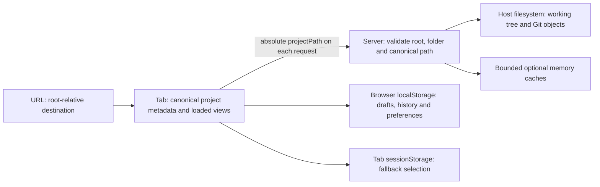

# Stateless project access

Status: implemented, independently reviewed and accepted on 2026-10-06

Created: 2026-10-05

The maintainer encountered project-read errors after a server restart: the browser retained its
selected project, while the server lost the registration required to use that project's ID. The
agreed change makes every project request independently resolvable from its canonical absolute
folder path. The maintainer requested implementation in this chat on 2026-10-06 after reaching a
stable point in the other chat. The maintainer approved committing the independently reviewed result
on 2026-10-06.

## Agreed decisions

- Remove the server's opened-project registry and the requirement to register a folder before
  reading it. Selecting a folder remains a user action, with a stateless metadata lookup.
- Use the canonical absolute folder path as project identity throughout current API contracts,
  client state, feedback ownership, persistence and caches. Remove the separate hashed project ID
  and `projectId` fields rather than putting a path into a field still named as an ID.
- Resolve and validate the requested folder under the configured approved root on every project
  request. Keep repository access read-only and retain existing file/Git/media boundaries.
- Caches remain optional, bounded performance aids with their existing resource/version policies. An
  empty cache or a new server process must not prevent an otherwise valid project read.
- **No preservation, migration or backward compatibility is required.** The maintainer is the only
  user and explicitly accepted discarding existing local review data. Start affected project data
  fresh; remove old ID-based API routes, storage migrations and legacy backup support. Do not add a
  compatibility hash, ID-to-path adapter, dual-format reader or transition period.
- Keep this as a focused architecture change. It adds no accounts, synchronization, repository
  writes, offline project copies or feedback that follows a folder rename.

This deliberate API/storage break is an explicit exception to the compatibility requirements of the
[engineering conventions](engineering-conventions.md#runtime-validation) for this work only.
Behavior records now describe the path-based implementation; dated checkpoints preserve earlier
implementation evidence.

## Result from the user's point of view

1. Choose a folder inside the approved host root, or open a project destination. Resolve it to a
   canonical absolute path and display name. Git projects enter Changes; other folders enter Files
   with the existing phone/tablet/desktop navigation behavior.
2. Browse Changes, Files, Search, branches, commits and media. Each request supplies the project
   path and validates the folder independently; no earlier lookup is a prerequisite.
3. Create comments and copy feedback as today. New drafts, copy history and project preferences are
   saved under the canonical path. They remain local to this browser origin and survive reload.
4. Restart the server while the tab or installed app stays open. The next project read succeeds
   without choosing the folder again, reloading the page or restoring a registration. A request
   interrupted by the restart can fail normally; retry must work once the host is available.
5. If the folder disappears, moves or becomes disallowed, show a precise error while retaining
   current user work. Never silently read another folder or attach feedback to it.

The first launch after this change starts affected local project data fresh. Only known obsolete
git-review project keys are deleted; unrelated storage and global preferences remain.

## Project contract and validation

Use one shared project resolver for the HTTP boundary. Selecting a folder may return its canonical
location; subsequent resource requests use that canonical absolute path. Keep the root-relative path
for picker/navigation representation, with an explicit name that distinguishes it from the absolute
identity. The returned record is:

```ts
type Project = {
  name: string;
  absolutePath: string;
  relativePath: string;
};
```

`relativePath` is derived from the approved root and canonical folder. It is navigation metadata,
not a second independent identity. Existing root-relative picker and browser-route representations
can stay where useful; route resolution derives the absolute candidate from the current approved
root. The server remains the authority for canonicalization and containment. No support for obsolete
routes or persisted navigation formats is required.

For every project read:

1. Parse exactly one bounded `projectPath` string. Require an absolute path; reject missing,
   duplicate, malformed or oversized input and null bytes before filesystem/subprocess work.
2. Resolve its real location, confirm it exists and is a directory, and verify containment using
   path components rather than a string-prefix check. A folder outside the approved root is rejected
   even if reached through a symlink.
3. Compare the requested canonical absolute path directly with the resolved real path; no previous
   selection or server memory is needed. Reject a different resolved location instead of silently
   changing project ownership. Selection lookup can normalize an allowed alias; clients store and
   subsequently request the returned path, replacing the URL's project path while preserving its
   section and destination.
4. Build the validated project record for this request and pass it to existing domain readers. File
   paths remain project-relative and use the checked working-file/Git boundaries.

Keep project-level missing/changed/disallowed errors distinct from file-level absence so feedback
checks cannot mistake a lost project for an outdated line. Use precise shared types and boundary
parsers; avoid pervasive casts or optional properties.

## API shape

Use a singular `/api/project` family with `projectPath` carried by `URLSearchParams`. Avoid
embedding an arbitrary absolute path into a route segment. Keep separate query fields for
project-relative files, Git layers/sides, revisions, media versions, languages and history
pagination.

| Route family                                                                | Purpose                                                     |
| --------------------------------------------------------------------------- | ----------------------------------------------------------- |
| `GET /api/project?projectPath=…`                                            | Stateless selection/metadata lookup returning `{ project }` |
| `GET /api/project/status?projectPath=…`                                     | Working-copy Git inventory                                  |
| `GET /api/project/diff` and `POST /api/project/diffs`, with `projectPath`   | Single and bounded batch working-copy comparisons           |
| `GET /api/project/tree?projectPath=…&path=…`                                | Working-tree directory listing                              |
| `GET /api/project/file?projectPath=…&path=…&source=worktree`                | Working-tree file read                                      |
| `GET /api/project/search?projectPath=…&query=…`                             | Project search                                              |
| `GET /api/project/git/refs` and `/git/log`, with `projectPath`              | Branches and paginated history                              |
| `GET /api/project/git/commits/<oid>` and its `/diff`, with `projectPath`    | Commit detail and historical file comparison                |
| `POST /api/project/git/commits/<oid>/diffs`, with `projectPath`             | Bounded batch historical comparisons                        |
| `GET /api/project/raw/file`, `/raw/diff`, `/raw/commit`, with `projectPath` | Image/audio/video reads, HEAD and ranges                    |

Root/directory discovery, language discovery and transcription retain their separate roles. Delete
`POST /api/projects/open`, ID-based routes and their unopened-project errors. Update generated raw
media URLs and their parsers with the new contract. Every resource route must work against a fresh
handler without calling the selection lookup first.

## Client state, local data and caches

- Replace ID-based ownership across App, project/session loading, working-copy review, Git browsing,
  diff/file views, selections, language overrides and feedback transactions with canonical absolute
  project paths. Rename opening/handle concepts where they imply a server registration.
- Preserve URL ownership, independent tab selection, synchronous navigation references, saving
  editors before in-app navigation, request cancellation and rejection of superseded responses. A
  result or pending clipboard operation must still belong to its original project and version.
- Define new versioned project storage and backup formats using paths. Reset affected old
  project/session/recents/comment/history/open-card/language records without migrating them. Remove
  obsolete format readers and imports; newly created data still gets strict validation and local
  export/import. Scope cleanup to known git-review keys rather than clearing browser storage.
- Keep global appearance, typography and wrapping independent of project identity. Their current
  formats need not change merely because project storage changes; no legacy format support is needed
  for this slice.
- Update cache and request-queue keys to include the canonical project path. Preserve bounded
  retention, immutable commit identities, mutable-resource versions and stale/error exclusion. Use
  structured tuple encoding where compound path keys could be ambiguous.
- Do not cache approval in place of per-request folder validation. Keep the service worker's
  offline-fallback behavior; API responses and raw project media remain uncached there.

## Edge cases

- Approved root selected as the project; nested folders; non-Git folders; spaces, Unicode,
  URL-special characters, and literal backslashes in project-relative file/media paths. Encoding
  must round-trip exactly. The existing root-relative folder picker does not support backslash
  folder names; this cutover does not broaden that picker contract.
- Relative paths submitted to the absolute-path API, sibling-prefix escapes, aliases, links outside
  the root, removed/renamed folders, invalid query fields and unavailable host storage.
- Moving a folder changes its identity. Replacing contents at the same canonical path keeps the
  folder identity; existing source/version and comment-anchor checks still govern fresh data.
- Changes to the configured approved root must not accept saved destinations outside the new root. A
  request failure must retain current drafts and distinguish project failure from file absence.
- Two tabs/devices continue to read the same host data. Feedback remains browser-local; simultaneous
  edits to one project's drafts in two tabs still have no coordinated merge.
- Server restarts, empty caches, delayed results during project switches, raw media links,
  HEAD/range requests and pending feedback checks/copy must not require registration or cross
  project owners.

## State and lifecycle after cutover



The host filesystem is the source of truth for project contents. Server memory holds configuration,
bounded caches and temporary subprocess/transcription work. It has no project registry, active
project or feedback store. A restart clears that runtime memory; the next request reconstructs its
validated project from the absolute path and reads the host again.

The browser owns navigation and review work. URLs, recents and tab fallback selections retain
root-relative navigation paths. Once resolved, loaded views, feedback ownership and API requests use
the canonical absolute path. Reload clears tab-memory caches and restores current local data.
Closing an ordinary tab ends its session selection subject to browser session restore; saved
comments remain in that browser origin. Another device shares host files, but has its own feedback
storage. Moving a project changes its identity; existing new-format feedback stays under the
original absolute path.

Current project formats are workspace v4, active-project v2, comment store v4, and backup v6.
Comments/open cards/languages use new v2 storage namespaces with URI-encoded path suffixes.
Appearance, typography and wrapping retain their standalone formats. There are no old-format readers
or backup migrations; cleanup deletes known obsolete keys without reading their values. Backup
export includes only projects within the current approved root, leaving valid records from other
roots in browser storage. Import still requires matching root ownership.

## Implementation and review sequence

| Step | Reviewable result                                                                                | Status   |
| ---- | ------------------------------------------------------------------------------------------------ | -------- |
| S01  | Shared absolute-path project resolver and boundary regression tests                              | Complete |
| S02  | Complete path-only API/client/storage/backup cutover, registry/ID removal and updated QA callers | Complete |
| S03  | Restart and end-to-end verification, behavior-record updates and maintainer handoff              | Complete |

The smallest useful delivered slice is S02 plus its verification: all project resources work without
registration, and new local feedback persists correctly. Review the resolver first, then make the
API and all its consumers switch together so the maintained app does not receive a partially
converted contract. No temporary compatibility routes or dual identities are part of the delivery.

The maintenance pass and subsequent batching/bulk-control work are complete and committed. The
2026-10-06 baseline is `cadb8ed`; only this plan and its index link were uncommitted at startup.
Include the newer working-copy and commit batch endpoints, request queues and lightweight status
checks in the cutover. Keep completed changes uncommitted until explicit maintainer commit approval.

## Verification and completion criteria

- Focused boundary/API tests: fresh handlers can serve every project route without selection;
  canonical identity, invalid/missing/duplicate paths, containment, folder absence and raw media
  parsing preserve clear error boundaries. Empty caches do not affect correctness.
- Browser restart regression on an isolated fixture root and port: leave a project open with new
  drafts and an editor in progress, restart only that QA backend, then browse/refresh/check/copy
  without reopening or reloading. Cover Changes, Files, Search, Git and raw media; retry an
  interrupted request once the backend returns. Cleanup only QA processes started for this work.
- New-storage checks: fresh project data, saved drafts/history/preferences after reload, independent
  projects/tabs, selection feedback, checked copy/Undo, new backup export/import and deliberate
  rejection of unsupported old backups. Test known-key cleanup without deleting unrelated data.
- Run `bun run format`, `bun run format:check`, `bun run typecheck`, `bun run test` and
  `bun run qa:check`; update affected QA fixtures/callers and run focused project, navigation,
  loading, feedback, Git and media browser checks. Rebuild client assets and restart relevant
  maintained backends for the completed cutover.
- Check narrow/touch layouts, wrapping and overflow. For any visible UI change, capture and inspect
  phone, tablet portrait, tablet landscape and desktop with `bun run qa:capture`; link useful
  milestone images. State real-device/PWA/clipboard/microphone checks separately from emulation.
- Update foundation, API/Git/file/media, feedback/storage/backup, loading/navigation, state
  ownership and QA records to the final behavior. Historical records may describe the old design as
  history, but active instructions must no longer require an opened ID or promise discarded
  compatibility.
- Record test evidence and remaining limitations here. Confirm that current runtime contracts no
  longer contain a hashed project ID or registry, old local formats have no migration path, and
  ordinary restart recovery requires no selection handshake.

## Review boundary

All three steps belong to the agreed cutover. Keep the delivery uncommitted for maintainer review;
implementation approval does not authorize a commit.

## Delivery evidence — 2026-10-06

The resolver, every API/client caller, feedback/cache ownership, storage and backup formats,
generated media URLs, boundary parsers and active QA callers have switched together. Old registry
routes return 404. All resources work against fresh handlers without metadata lookup, including
lightweight status, working-copy and commit batches, and raw GET/HEAD. Missing and changed projects
have distinct errors.

A live Chrome regression restarted its owned backend twice without reloading or selecting the
project again. Saved drafts and an editor remained usable, resource reads and checked copy
succeeded, and a read during downtime recovered through Retry. The script uses an unusual canonical
folder name containing spaces, a colon, Unicode and URL-special characters.

Verification:

- `bun run format`, `bun run format:check`, `bun run typecheck`, `bun run test` (203 tests) and
  `bun run qa:check`; boundary tests include fresh access, query validation, project changes,
  encoded media URLs, scoped old-data deletion, new backup round-trip and failed-write rollback.
- Chrome checks passed: restart, independent tabs, project entry (320/390/600/601/820/1180/1440 px),
  navigation, history controls, loading and stale-result ownership, both batch/bulk flows, Files,
  Search, feedback transactions, line/file/selection feedback, PWA backup/import/offline behavior,
  SVG safety and audio/video playback/ranges. File and selection feedback cover 320 px plus all four
  standard profiles. Clipboard was real desktop Chrome in the restart/feedback flows and controlled
  promises in the transaction-race checks.
- Four-size local-data dialog captures were generated with `bun run qa:capture` and inspected for
  wrapping, clipping, controls and overflow:
  [phone](../qa/screenshots/stateless-project-data/mobile.png),
  [tablet portrait](../qa/screenshots/stateless-project-data/tablet-portrait.png),
  [tablet landscape](../qa/screenshots/stateless-project-data/tablet-landscape.png),
  [desktop](../qa/screenshots/stateless-project-data/desktop.png).
- Client assets rebuilt and both maintained HTTP/private-HTTPS backends restarted. Live requests
  verified path metadata and status without registration. Only owned QA servers were stopped.

The review started from `cadb8ed`; the initial handoff was uncommitted. Reload an existing review
tab once to load this deliberately incompatible client/storage release. Subsequent backend restarts
need no new project selection. Physical-device gestures, installed iOS/Android recovery, real
microphone capture and device clipboard permissions remain unverified for this cutover.

Independent review found and resolved a backup-export regression after switching or narrowing the
approved root, plus an existing alias deep-link gap in the promised canonicalization flow.
Regression tests cover all three storage namespaces, malformed keys and unchanged out-of-root
storage; Chrome covers the canonical URL, preserved file/line destination, one lookup, history
replacement and restart recovery. Redundant query-string conversions were removed. The follow-up
review found no further actionable concerns. The maintainer accepted the result and authorized its
commit.
